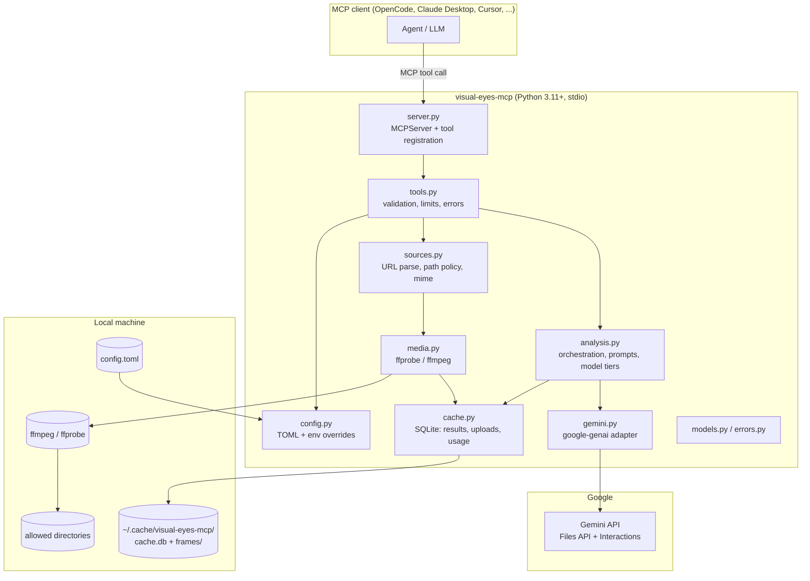

# visual-eyes-mcp — Architecture

**Status:** Phase 1.6 — planning finalised after the verification review. No application code exists.
**Research date:** 2026-11-14. Facts marked `[verified]` come from official documentation or SDK
source; `[unverified]` means untested backend behaviour that only an implementation spike can settle.
**Canonical decision log:** `TECHNICAL_DECISIONS.md` §1.

---

## 1. Purpose

`visual-eyes-mcp` is a local, stdio-based MCP server that gives an AI agent three things it
cannot do with text alone:

1. **Answer questions about a video** (whole video or a time range), with approximate timestamps.
2. **Locate relevant moments** in a video from a natural-language description.
3. **Show the agent actual frames** at chosen timestamps, extracted locally.

The primary audience is coding agents working with conference talks, screencasts, tutorials, and
bug reproductions. Nothing is specific to OpenCode: it speaks standard MCP.

---

## 2. Design principles

| Principle | Consequence |
| --- | --- |
| One developer maintains it | ~11 modules, one paid service (Gemini), one store (SQLite), no workers |
| Cost and quota are features | Cache-first, local preflight, hard per-call caps, no retry on daily-quota errors |
| Least privilege by default | Reads only inside explicitly allowed roots; only video files; uploads only from paid tools |
| Local work stays local | ffprobe/ffmpeg never touch the network |
| Honest about limits | Approximate timestamps; unverified behaviours surfaced as `warnings`, never asserted |
| Extensible without abstraction theatre | One provider-neutral model layer, one adapter module |
| No capability bypass | No downloading of platform media, no DRM, no auth circumvention |

### 2.1 Verified vs unverified

The documents use three labels consistently:

- `[verified]` — stated in official docs, or present in the pinned SDK's types.
- `[unverified]` — plausible but backend-dependent, or documentation conflict; must be tested in M5
  before any doc claims it works.
- `[decision]` — a product/architecture choice that does not depend on provider behaviour.

This matters because the current Gemini API surface (`interactions.create`, `processing`,
`store`, `response_format`) is newer than most published examples: type-level acceptance is not
proof that a specific combination works.

---

## 3. System architecture



### Component responsibilities

| Module | Owns | Must not own |
| --- | --- | --- |
| `server.py` | `MCPServer`, tool registration, server instructions (including privacy notice), `main()` | Business logic, network calls |
| `tools.py` | Tool signatures, argument coercion, allowed-dir enforcement entry point, limit enforcement, error mapping | Prompts, SQL, SDK calls |
| `sources.py` | YouTube canonicalisation, path resolution/containment, regular-file and extension checks, source fingerprints | ffprobe execution |
| `media.py` | ffprobe validation, frame extraction, optional clipping, subprocess hardening | Network, model logic |
| `analysis.py` | Prompt construction, model-tier resolution, detail mapping, calling the adapter, normalising results, warnings | SDK types leaking out |
| `gemini.py` | Client construction, Files API upload/reuse, `interactions.create`, usage extraction, `store` flag, error translation | Cache policy, path policy |
| `cache.py` | Schema, cache keys, TTLs, frame files, **usage counters**, pruning, atomic writes | Deciding whether caching is desirable |
| `config.py` | TOML load + env overrides, frozen validated settings, masked secrets | Reading env at call time |
| `models.py` | Pydantic input/result models shared by tools, cache, provider | I/O |

`analysis.py` is the **provider seam**: tools see only provider-neutral models. Replacing Gemini
means rewriting `gemini.py` plus prompt builders — not the tool surface, cache, or their tests. No
ABC, no registry, no entry points.

---

## 4. Data flow

### 4.1 `analyze_video(source, question, start_seconds?, end_seconds?, detail?, refresh?)`

```
0. config.py     resolve model tier from `detail` (normal → default model, high → model_high)
1. tools.py      validate lengths/range; announce that the source will be sent to Google
2. sources.py    parse source → SourceRef(kind, canonical_id, fingerprint)
3. path policy   local only: resolve(), containment in allowed root, regular file,
                 extension allowlist; failure = AccessDenied, no upload
4. media.py      ffprobe: has video stream? duration/width/fps/mime acceptable? size cap?
5. estimate      processed_seconds = clipped range if usable else full duration
                 estimated_tokens ≈ processed_seconds × 100 (low-res static baseline)
6. cache.py      lookup(fingerprint, tool, normalised params, resolved model, prompt/schema ver)
                   hit → return, zero tokens
7. quota         RPD (Pacific date) → per-call token cap → TPM/RPM sliding window → concurrency
8. gemini.py     upload if local and no live upload ref (< 48 h); poll ACTIVE with timeout
9. gemini.py     interactions.create(model, input=[video, text], response_format=…,
                                     store=false, deadline)
10. analysis.py  parse → VideoAnswer; clamp timestamps to known duration; attach warnings
11. cache.py     write result + actual usage counters
12. tools.py     structured content + short text summary
```

### 4.2 `find_moments(source, description, max_results?, start_seconds?, end_seconds?, detail?, refresh?)`

Same pipeline, different response schema. For long videos the request may use Gemini's agentic
video processing **if the selected model supports it** — `[unverified]` for 3.8 Flash and 3.5
Flash-Lite despite the video-understanding guide listing them; only Hydrogen's model page badges
it. If the API rejects the mode, fall back to static and add a warning.

### 4.3 `extract_frames(source, timestamps[] | interval_seconds, max_frames?, width?)`

```
1. path policy + ffprobe validation (same as above)
2. ffmpeg -ss T -i file -frames:v 1 -vf scale=W:-2 out.jpg
3. cache by (source fingerprint, timestamp_ms, width)
4. return image content blocks + metadata block
```

No upload, no model call, no tokens. Local files only `[decision]`.

### 4.4 `video_info(source)`

ffprobe for local files; URL validation and cache/usage statistics for YouTube. Never calls Gemini.
Returns a read-only `limits` block so the agent can budget before spending.

### 4.5 Local vs remote operations

| Operation | Where | Tokens |
| --- | --- | --- |
| Config load, URL/path validation, hashing | local | 0 |
| ffprobe, frame extraction, scaling, frame cache | local | 0 |
| SQLite reads/writes, quota counters | local | 0 |
| Files API upload | Google, free per docs `[verified]` | 0 |
| Analysis / moment search | Gemini inference | billed |
| Viewing returned images | calling agent | client-side |

---

## 5. Video input strategy

Documented input methods `[verified]`: Files API upload, GCS registration, inline data, public
YouTube URLs, and public/pre-signed HTTPS URLs (15 MB per file — unusable for video, deliberately
not exposed).

| Source | v1 approach | Rationale |
| --- | --- | --- |
| Local file | Files API; upload once, reuse URI until 48 h expiry | Inline base64 duplicates the video per request; 2 GB/file, 20 GB/project |
| Public YouTube | URL passthrough as a `video` part | No download, no re-hosting, no ToS exposure |
| Other URLs / GCS / HLS | Rejected with a clear message | 15 MB cap; auth/egress/trust cost; no MVP need |

Details that must be honoured:

- Poll `files.get` until `ACTIVE`, with a timeout; `FAILED` is a provider error.
- Cache upload `name`/`uri` with an expiry check; never assume yesterday's upload survives.
- Accepted mimes `[verified]`: `mp4`, `mpeg`, `mov`, `avi`, `x-flv`, `mpg`, `webm`, `wmv`, `3gpp`.
  `.mov` is **ambiguous across docs** (`video/mov` in the SDK and video guide, `video/quicktime`
  in the file-input guide) `[unverified]` — probe, normalise, prefer mp4, verify in M5.
  MKV is not accepted; fail with a "remux to mp4" message rather than a cryptic API error.
- Video part before the text prompt `[verified recommendation]`.
- Clipping (`processing: {type: "static", start_offset, end_offset, fps}`) `[verified type-level]`.
  Whether offsets reduce billed tokens for local uploads is `[unverified]`; whether they apply to
  **YouTube URLs at all** is `[unverified]`. Until M5 proves otherwise, assume a YouTube range
  query processes the whole video and say so in `warnings`.
- `store=false` is the preferred privacy setting `[decision]`; its interaction with video and
  agentic processing is `[unverified]` and must be tested in M5. If it breaks a workflow, default
  to the provider's behaviour and document it.

---

## 6. Caching, persistence, and quota accounting

Single SQLite file (`cache.db`, WAL) plus a `frames/` directory. No server, no daemon.

```sql
sources(id TEXT PK, kind TEXT, canonical_id TEXT, path_or_url TEXT,
        duration_s REAL, size_bytes INTEGER, mime TEXT,
        first_seen_at INTEGER, last_seen_at INTEGER)

uploads(id TEXT PK, source_id TEXT, uri TEXT, mime TEXT,
        uploaded_at INTEGER, expires_at INTEGER)          -- now + 48 h

analyses(cache_key TEXT PK, source_id TEXT, tool TEXT, request_json TEXT,
         result_json TEXT, model TEXT, detail TEXT,
         input_tokens INTEGER, output_tokens INTEGER,
         created_at INTEGER, expires_at INTEGER, hit_count INTEGER)

frames(id TEXT PK, source_id TEXT, timestamp_s REAL, path TEXT,
       width INTEGER, height INTEGER, created_at INTEGER, last_used_at INTEGER)

usage_counters(pacific_date TEXT, model TEXT, requests INTEGER, input_tokens INTEGER,
               output_tokens INTEGER, PRIMARY KEY (pacific_date, model))
```

Rules:

- Cache key includes **source fingerprint, tool, normalised params, resolved model, detail level,
  prompt version, schema version**. Prompt edits invalidate instead of poisoning.
- TTL: analyses 7 days, uploads 48 h, frames 30 days idle; all configurable.
- **No video bytes are stored.** Derived text and derived frames only.
- `refresh: true` is the only way to force a paid re-run.
- Usage counters are per **America/Los_Angeles** day (the documented RPD reset point `[verified]`;
  per-project behaviour is U8); `zoneinfo` with UTC fallback plus a warning if the tz database is
  unavailable.
- Writes are atomic; frame pruning is oldest-first at `max_cache_mb`.
- Cache hits are surfaced (`cache.hit: true`) so the agent can report reuse.

---

## 7. Security, privacy, and trust boundaries

### 7.1 Local file policy `[decision]`

**No unrestricted filesystem access by default.** HOME is not implicitly trusted.

| Rule | Implementation |
| --- | --- |
| Explicit roots | `paths.allowed_dirs` in TOML (absolute paths), plus optional process CWD as a development convenience (`include_cwd`, default true) |
| Empty policy | If no root resolves, local tools fail with `AccessDenied` and instructions to configure one — fail-closed |
| Traversal | `Path.resolve(strict=True)`; containment via `os.path.commonpath` on resolved paths; `..` outside roots rejected |
| Symlinks | Containment is checked **after** resolution, so a symlink escaping a root is rejected; dangling symlinks and links to non-regular files rejected |
| File type | `stat.S_ISREG` only (no FIFOs/devices/directories); extension allowlist **and** ffprobe-confirmed video stream |
| Size | `max_file_size_mb` default 1024 (API ceiling 2 GB) checked before any read/upload |
| Media validation | ffprobe before upload: container, video stream present, duration, dimensions, fps; unsupported/oversized rejected with an actionable message |
| Upload scope | Only `analyze_video` / `find_moments`; `extract_frames` and `video_info` never upload |

The same-user TOCTOU window (file swapped between check and open) is accepted and documented: an
attacker who can replace files in the user's own allowed directories already has the user's
privileges. This is not a sandbox.

### 7.2 Data egress

A local file passed to a paid tool is **uploaded to Google**. This is stated in:

- the tool description the model reads,
- the server `instructions`,
- the README privacy section,
- an INFO log line per upload (basename + size; full path only at DEBUG).

The client's tool-approval UI is the real consent gate; the server does not pretend to enforce
consent against the agent that controls it. It does ensure uploads are never implicit side effects
of unrelated calls.

### 7.3 External inputs and secrets

| Concern | Decision |
| --- | --- |
| API key | `GEMINI_API_KEY` / `GOOGLE_API_KEY` env only; masked type whose `repr` is `***`; never a tool argument, never in TOML, never in SQLite |
| Logging | Startup logs `api_key_present`; a redaction filter scrubs the key and `x-goog-api-key`; no raw request/response bodies or full prompts at INFO; provider exceptions sanitised before surfacing |
| YouTube / SSRF | Only `youtube.com`, `www.youtube.com`, `m.youtube.com`, `youtu.be`; no userinfo/ports/IDN lookalikes; extract `[A-Za-z0-9_-]{11}` and **rebuild** the canonical URL; never forward the raw string; playlists/live rejected. The process never fetches the URL — Gemini does |
| Prompt injection via video | Video treated as untrusted data; prompt instructs the model to ignore in-video instructions; tool text tells the agent results are untrusted |
| SQLite | Parameterised statements only, WAL, `busy_timeout`, extensions disabled, DB `0600` in a `0700` dir, cached payloads revalidated against the current schema and dropped on mismatch |
| FFmpeg | argv list (never `shell=True`), numeric coercion, `-nostdin -hide_banner -loglevel error -protocol_whitelist file`, timeout, temp output paths, stderr truncated and path-scrubbed |
| Resource exhaustion | File-size, duration, token, frame-count, width, timeout, and concurrency caps (MVP §5); no 8K/long-decode attempts |
| Cache contents | May contain sensitive on-screen content; directory permissions and README warning |

### 7.4 Threat model not covered in v1

Hostile local user, multi-tenant isolation, network exposure. There is no listening socket.

---

## 8. Failure model

Error classes exist so the *agent* can act, not just the developer.

| Class | Example | Behaviour |
| --- | --- | --- |
| `ConfigError` | missing key, invalid TOML | Paid tools fail with an actionable message; local tools usable; server still starts |
| `AccessDenied` | path outside allowed roots, symlink escape, no roots configured | Deterministic, no retry, message explains configuration |
| `InvalidSource` | private YouTube URL, unsupported host/codec, not a regular file | No retry |
| `LimitExceeded` | duration, tokens, frames, size, processing time | Message names the limit and suggests narrowing the range |
| `QuotaExhausted` | RPD reached, configured budget exhausted | **No retry**; states the reset window; cached results still available |
| `ProviderError` | 4xx, safety block, malformed structured output | No retry except one schema re-ask |
| `TransientError` | 429 RPM/TPM, 5xx, timeout | ≤2 retries, exponential + jitter, honour `Retry-After`, within the deadline |
| `ProcessingError` | ffmpeg missing/failed | Suggest installing ffmpeg; local tools degrade, provider tools unaffected |

Every paid call carries a wall-clock deadline. A timeout returns an error rather than leaving the
MCP call open until the client gives up.

---

## 9. Future remote deployment (designed for, not built)

Because all state sits behind `cache.py` and all model calls behind `gemini.py`, Streamable HTTP is
additive: the SDK exposes `streamable_http_app()`, and serving becomes a transport choice.

New concerns that are explicitly **not** solved now: authentication/authorisation, per-caller
quotas, shared cache (SQLite → server store), frame storage, request-state keys for multi-replica
retries, and abuse controls (a public endpoint spending the operator's Gemini budget is a different
product). Content-derived cache keys translate cleanly to a shared store.

Explicitly rejected for v1: HTTP transport, Docker, Redis, Postgres, Celery, Kubernetes.

---

## 10. Known architectural risks

1. **Unverified provider behaviour.** YouTube clipping, `store=false` with video, agentic video on
   Flash-Lite, and `.mov` mime handling are all unresolved until M5. The plan degrades safely:
   full-video processing + duration/token caps + cache.
2. **Whole-video cost on YouTube.** If clipping is unsupported, a 1-hour video is ~360k input
   tokens per question — above a 250K TPM budget, therefore refused by preflight rather than
   attempted.
3. **Timestamp precision.** Default 1 FPS sampling means timestamps are approximate (±1–2 s).
   Never described as frame-exact.
4. **Model quality is not benchmarked.** Vendor positioning is not evidence; M5 includes a small
   fixed-clip comparison, and the default may change as a result.
5. **Quota variance.** Free-tier limits differ per project and change; quotas live only in local
   config, and the public package throttles nothing by default.
6. **Provider API churn.** The Interactions surface is new; the adapter stays thin and pinned.
7. **Long MCP calls.** A 2-minute analysis can exceed a client's tool timeout; defaults stay
   short, progress reporting is a later milestone.
8. **Files API expiry.** 48 h retention forces expiry checks, not assumptions.
